# Pendientes — BarrioDigital Prueba 2 (EP3 + EP4)

Backlog único de la etapa de RabbitMQ. Cada ítem tiene prioridad, repo afectado y **el % de rúbrica que
desbloquea**. El análisis completo del estado actual está en [Cumplimiento-Prueba2.md](Cumplimiento-Prueba2.md);
las justificaciones de diseño en [Justificacion-Mensajeria.md](Justificacion-Mensajeria.md); el guion de la demo en
[Guion-Presentacion-Prueba2.md](Guion-Presentacion-Prueba2.md).

| Área | Doc con el detalle |
|---|---|
| Pauta del encargo (EP3) | [Pauta_Encargo_Prueba2.md](Requisitos%20de%20la%20Prueba/Pauta_Encargo_Prueba2.md) |
| Pauta de presentación (EP4) | [Pauta_Presentacion_Prueba2.md](Requisitos%20de%20la%20Prueba/Pauta_Presentacion_Prueba2.md) |
| Decisiones de arquitectura | [Justificacion-Mensajeria.md](Justificacion-Mensajeria.md) |
| Pendientes heredados de EP1 | [Pendientes.md](Pendientes.md) |

> **Los IDs de este doc son independientes** de los de [Pendientes.md](Pendientes.md) (EP1): ahí `F3` y `F5`
> son ítems de GitHub, aquí son del bloque de infraestructura. Al hablar, decir "F3 de Prueba 2".

> **Estado al 18-10-2026.** Mergeado en `main` con CI verde: B1–B2, C1–C8 (Benjamín; C8 completado en
> `rabbitadmin` e infra), E1–E2, G4 y D11. Antes ya estaban cerrados I1, I3, I4, A1–A5, D1–D9, F1–F8, G1–G3, G5 y H3.
> **Desplegado y verificado el mismo día:** 8 contenedores sin reinicios, los 3 flujos procesados contra el clúster
> (2 por `cmd.topic`), DLQ con `log.error` y `x-death`, `/login` en 200. **Queda:** I2 (Entra, portal) · H4
> (capturas) · H5 (ensayo). Lo opcional: D10, D12, G6, G7, H6.

**Prioridades:** `P0` = sin esto se pierden puntos de la rúbrica · `P1` = pedido por el caso o necesario para la
demo · `P2` = deseable / mejora.

**Orden sugerido:** I → A → B → C → D → F → G → E → H. Los bloqueadores heredados (I) van primero porque **no son
trabajo de código** y sin ellos no hay demo que ensayar.

---

## Reparto y paralelismo

**Las 4 EC2 están corriendo** (verificado el 15-10-2026: `ec2-apps` t3.medium · `ec2-db` t3.medium ·
`ec2-mq` t3.small · `ec2-kafka` t3.medium, todas `us-east-1a`, 3/3 comprobaciones). Eso significa que el bloque
del clúster **no espera a nada**: se puede empezar hoy.

### Quién lleva qué

| | **Francisco** | **Benjamín** |
|---|---|---|
| Eje | **AWS, infraestructura y plano de control** | **Identidad y plano de datos (mensajería)** |
| Bloques | **F** (clúster MQ) · **D** (MS administrador, código + despliegue) · **G** (pantallas) · I3, I4, H4 | **I1, I2** (desbloqueo) · **A → B → C** (backend mensajería) · **E** (topic) · G5 · H1–H3 |
| Puntos de rúbrica | **24%** (D) + el motor del **20%** (G) + los ítems 8, 9, 11 de EP4 | **38%** (A 10% + B 12% + C 16%) + ítem 10 de EP4 |

El criterio no es "quién sabe más de qué", es **qué archivos toca cada uno**: los dos ejes no se pisan en ningún
archivo (con dos excepciones, abajo). Francisco además tiene la consola de AWS, así que todo lo que pasa por ahí es
suyo por definición.

### Las dos trampas: tareas de infra que tocan código de backend

Esto rompería el paralelismo si se reparte por etiqueta en vez de por archivo:

| Ítem | Está en el bloque de infra, pero… | Decisión |
|---|---|---|
| **F3** (colas quorum) | edita `notify/amqp/RabbitTopologyConfig.java`, **el mismo archivo que A3** | **Lo hace Benjamín**, dentro de A3. Es cambiar `QueueBuilder.durable(x)` por `.quorum()`: una línea |
| **F5** (`addresses` para failover) | edita los `application.yml` que **A2 y C1 también modifican** | **Lo hace Benjamín**, después de C1. Francisco solo le pasa las dos IP:puerto |

Todo lo demás de **F** es `barriodigital-infra/mq/**` y nunca lo toca Benjamín. **D8–D10** son
`barriodigital-infra/apps/**`: archivo distinto de `mq/`, así que Francisco puede trabajar en ambos sin conflicto
consigo mismo.

### Olas de trabajo

```mermaid
flowchart LR
    subgraph O1["Ola 1 - arrancar ya, 0 dependencias"]
        FA["F: F1 F2 F4<br/>rabbitmq.conf, puertos, .env"]
        BA["B: I1 I2<br/>GHCR publico + Entra"]
    end
    subgraph O2["Ola 2 - en paralelo"]
        FB["F: D1-D6<br/>codigo del MS admin"]
        BB["B: A1-A4 + F3<br/>centralizar nombres"]
    end
    subgraph O3["Ola 3 - en paralelo"]
        FC["F: D7-D10<br/>Dockerfile, CI, compose, heap"]
        BC["B: B1-B2 then C1-C7<br/>listeners + ACK manual"]
    end
    subgraph O4["Ola 4 - converge"]
        FD["F: F7 I3<br/>cluster_status + deploy"]
        BD["B: E1-E2 F5 G5"]
    end
    subgraph O5["Ola 5 - cierre"]
        FE["F: G1-G3 pantallas"]
        BE["B: H1-H3 docs"]
    end
    O1 --> O2 --> O3 --> O4 --> O5 --> FIN["Los dos:<br/>H4 capturas + H5 ensayo"]
```

| Ola | Francisco | Benjamín | ¿Simultáneo? |
|---|---|---|---|
| **1** | **F1, F2, F4** — `rabbitmq.conf` con peer discovery, puertos del nodo 2, `mq/.env.example`. `ec2-mq` ya está arriba | **I1, I2** — packages GHCR a público y Entra ID. **No es código y bloquea todo**: va primero | ✅ Total |
| **2** | **D1–D6** — el MS administrador. Repo nuevo: **cero conflictos** con cualquier otra cosa | **A1–A4 + F3** — centralizar nombres en properties, y de paso las colas quorum | ✅ Total |
| **3** | **D7–D10** — Dockerfile, CI, entrada en `apps/compose.yml`, heap de 192m | **B1–B2 → C1–C7** — separar los 3 listeners, luego ACK manual. **Estrictamente secuencial entre sí** | ✅ Total |
| **4** | **F7, I3** — `cluster_status` con los 2 nodos y primer despliegue end-to-end | **E1–E2, F5, G5** — flujo por `cmd.topic`, failover, fix de cupos | ⚠️ I3 necesita que D7 y la ola 3 de Benjamín estén mergeadas |
| **5** | **G1–G3** — `/reports`, `/audit`, `/dashboard` | **H1–H3** — matriz al día, enlaces desde los README, `arquitectura.md` | ✅ Total |
| **6** | **H4** capturas de evidencia | **H4** capturas | Los dos: **H5 ensayo cronometrado** |

### Reglas de convivencia

1. **Una rama por bloque**, nombrada con el ítem: `feat/A-centralizar-nombres`, `feat/D-rabbitadmin`. Nada directo a `main`.
2. **`ms-barriodigital-notify` es de Benjamín** durante las olas 2 y 3. Francisco no lo toca — ni siquiera para F3, que por eso se reasignó.
3. **`ms-barriodigital-requests` lo tocan los dos**, pero en carpetas distintas: Benjamín en `amqp/` (A4, E1), Francisco en nada. G5 toca `web/TramiteController.java` y es de Benjamín. Sin colisión, pero merecen ramas separadas.
4. **`barriodigital-infra` es de Francisco**, completo: `mq/**` y `apps/**`.
5. **Punto de sincronización obligatorio al final de la ola 3:** Benjamín mergea A+B+C, Francisco mergea D. Recién ahí se despliega (I3). Antes de eso no tiene sentido: faltaría la mitad.

### Si vamos con el tiempo justo

Orden de sacrificio, del menos al más costoso:

1. **G6, G7** (panel de notificaciones, métrica de DLQ) — son `P2`, solo material de demo.
2. **G4** (mover login a `/login`) — la pantalla funciona, solo está en otra ruta.
3. **F5** (failover de cliente) — el clúster se demuestra igual sin él.
4. **D12** (ruta en el BFF) — el admin se demuestra con `curl` desde `ec2-apps`.

**No se sacrifica nunca:** C (16%), D1–D6 (24%), G1–G3 (mueven el 20%), F7 e I3 (sin ellos no hay demo).

> **Advertencia sobre la nota individual.** EP4 se califica **individual** aunque se presente en grupo, y la pauta
> dice que *"cada estudiante fundamenta la propuesta desarrollada"*. Con este reparto **Francisco no escribe el ACK
> manual (16%) y Benjamín no escribe el administrador (24%)**. Eso está bien para avanzar en paralelo, pero obliga a
> dos cosas: que cada uno **revise el PR del otro** en esos dos bloques, y que ambos puedan explicar en vivo los
> tramos marcados en negrita del
> [reparto del guion](Guion-Presentacion-Prueba2.md#reparto-quién-dice-qué).

---

## Trazabilidad: qué ítem cubre qué indicador

| Indicador de la pauta | % | Ítems que lo cubren |
|---|---|---|
| 1 — Nombres centralizados | 10% | A1–A4 — *Benjamín* |
| 2 — Beans Queue/Exchange/Binding | 10% | A3 (ya cumplido, no romperlo) — *Benjamín* |
| 3 — Config aislada de la lógica | 8% | ✅ ya cumplido — D6 lo protege |
| 4 — Consumidores por dominio | 12% | B1–B2 — *Benjamín* |
| 5 — **ACK explícito + errores** | **16%** | C1–C7 — *Benjamín*, revisa Francisco |
| 6 — MS administrador REST | 10% | D3 — *Francisco* |
| 7 — `RabbitAdminService` | 8% | D2 — *Francisco* |
| 8 — Validación de entrada | 6% | D4 — *Francisco*, revisa Benjamín |
| 9 — **Matriz de funcionalidades** | **20%** | G1–G4 *Francisco* · G5, H1–H3 *Benjamín* · y el cierre de A–F |
| EP4 ítems 8, 9, 11 | demo | F1, F2, F4, F6–F9 *Francisco* · A5 (quorum) *Benjamín* |
| EP4 ítem 10 | demo | E1–E2 — *Benjamín* |

---

## I — Bloqueadores heredados de EP1 (no son código)

**Ola 1, antes que cualquier cosa.** Ninguno es trabajo de programación y todos bloquean la demo.

- [x] **I1** `P0` **Francisco** — **G4 de EP1**: poner **Public** los packages en GHCR (serán **8** con el admin). Sin esto `ec2-apps` no puede hacer `docker pull` y no hay despliegue — repo: *ninguno, es GitHub*. Hecho; ver [Hallazgos §1](Hallazgos-Operacion.md): no era bloqueador
- [ ] **I2** `P0` **Benjamín** — **A1–A6 y A9 de EP1**: App Registrations, 4 App Roles, `requestedAccessTokenVersion: 2`, consent y al menos un usuario por rol. Bloquea los ítems 5 y 6 de EP4 — repo: *ninguno, es Entra*
- [x] **I3** `P0` **los dos** — primer despliegue end-to-end real y verificado. Hoy **nunca se ha corrido** el sistema completo
- [x] **I4** `P1` **Francisco** — cerrar el puerto 22 de `sg-apps` desde `0.0.0.0/0` (ítem 11 del runbook de EP1). Es tema de seguridad y puede salir en la presentación

## A — Centralizar los nombres de la topología · indicador 1 (10%)

**Benjamín**, ola 2. Durante este bloque `ms-barriodigital-notify` es suyo: nadie más lo toca.

- [x] **A1** `P0` crear `RabbitProperties` con `@ConfigurationProperties("barriodigital.rabbitmq")`: records anidados para exchanges, colas y routing keys — repos: `ms-barriodigital-notify`, `ms-barriodigital-requests`
- [x] **A2** `P0` declarar los nombres en los dos `application.yml` bajo `barriodigital.rabbitmq.*` — repos: `notify`, `requests`
- [x] **A3** `P0` `RabbitTopologyConfig` consume las properties en vez de `public static final`. **Mantener los 3 exchanges + 6 colas + 9 bindings tal como están** (eso es el indicador 2, ya cumplido) — repo: `notify`
- [x] **A5** `P0` *(era F3)* de paso, **colas quorum**: `QueueBuilder.durable(x).quorum()`. Se hace aquí y no en el bloque F porque es **el mismo archivo que A3** y si lo toca Francisco en paralelo, conflicto — repo: `notify`
- [x] **A4** `P0` eliminar los literales sueltos: `NotificationPublisher.java:14` (`EXCHANGE = "cmd.direct"`) y los `@RabbitListener(queues = "q.cmd.email")` → `queues = "${barriodigital.rabbitmq.colas.email}"` — repos: `requests`, `notify`

## B — Separar los consumidores por dominio · indicador 4 (12%)

**Benjamín**, ola 3. Va **después de A** y **antes de C**: los tres tocan las mismas clases.

- [x] **B1** `P0` dividir `CommandListener` en `EmailCommandListener`, `CrewCommandListener` y `CertificateCommandListener`, bajo `amqp/listener/`. `ProcessedEventsGuard` se inyecta en los tres — repo: `notify`
- [x] **B2** `P0` adaptar `CommandListenerTest` a las tres clases nuevas — repo: `notify`

> La corrección más barata de toda la pauta: separar una clase en tres vale 12%.

## C — ACK manual explícito · indicador 5 (16%, el más pesado)

**Benjamín**, ola 3, inmediatamente después de B. **Francisco revisa el PR**: es el 16% y él no lo escribe.

- [x] **C1** `P0` `spring.rabbitmq.listener.simple.acknowledge-mode: manual` y `default-requeue-rejected: false` — repo: `notify`
- [x] **C2** `P0` cada listener recibe `Channel channel` y `@Header(AmqpHeaders.DELIVERY_TAG) long tag` — repo: `notify`
- [x] **C3** `P0` crear `ComandoNoRecuperableException` para hacer explícita la clasificación del error — repo: `notify`
- [x] **C4** `P0` las tres rutas de decisión: éxito → `basicAck` · error **recuperable** → `basicNack(requeue=true)` acotado por reintentos · error **permanente** → `basicNack(requeue=false)` → DLQ directa. El short-circuit de idempotencia hace `basicAck` (un duplicado está procesado, no fallido) — repo: `notify`
- [x] **C5** `P0` **`log.error` en cada rama de NACK** con `eventId`, cola destino y motivo. La pauta lo pide literal: *"enviándolos a DLQ **y registrándolos en logs**"* — repo: `notify`
- [x] **C6** `P0` javadoc por listener explicando la decisión de error. La pauta exige que *"la lógica de error esté documentada"* — repo: `notify`
- [x] **C7** `P0` **test por rama** (ack / nack-requeue / nack-DLQ) con `Channel` mockeado, más el caso duplicado — repo: `notify`
- [x] **C8** `P1` *(era F5)* `spring.rabbitmq.addresses=10.0.1.254:5672,10.0.1.254:5673` para failover del cliente. Se hace aquí porque toca los `application.yml` que C1 ya modificó; Francisco solo pasa las dos `IP:puerto` — repos: `requests`, `notify`, `rabbitadmin`. **Antes:** abrir 5673 en `sg-mq` desde `sg-apps` (hecho el 15-10: `sgr-01821978696a4a75f`, probado desde `ec2-apps`)

## D — `ms-barriodigital-rabbitadmin` · indicadores 6, 7 y 8 (24%)

**Francisco**, olas 2 y 3. Repo nuevo, Spring Boot 3.3.5 / Java 17, puerto **8086**, **sin DB**. No requiere EC2
nueva ([por qué](Justificacion-Mensajeria.md#costo-que-aceptamos)). Al ser un repo que no existe, **no colisiona
con nada** de lo que haga Benjamín: es el bloque más paralelizable de la etapa.
**Benjamín revisa el PR**: son 24% y él no los escribe.

- [x] **D1** `P0` crear el repo con `spring-boot-starter-web`, `-amqp`, `-security`, `-oauth2-resource-server`, `-validation`, `-actuator`
- [x] **D2** `P0` **`RabbitAdminService`** sobre `AmqpAdmin`: `crearCola`, `eliminarCola`, `purgarCola`, `crearExchange`, `eliminarExchange`, `crearBinding`, `eliminarBinding`, `listar`. Los controladores **no conocen detalles de RabbitMQ** — es el texto literal del nivel 100% *(indicador 7, 8%)*
- [x] **D3** `P0` `QueueAdminController` (`POST /admin/queues`, `DELETE /admin/queues/{name}`, `GET /admin/queues`, `POST /admin/queues/{name}/purge`), `ExchangeAdminController`, `BindingAdminController` *(indicador 6, 10%)*
- [x] **D4** `P0` DTOs records con `@NotBlank`, `@Pattern` (nombres válidos, sin vacíos) y `@Min`; `@Valid` en los controladores y `ProblemDetail` con **mensajes claros** *(indicador 8, 6%)*
- [x] **D5** `P0` copiar las 4 clases de `cl.duoc.barriodigital.security` y gatear todo con `hasRole('Admin')`
- [x] **D6** `P0` **tests**: validación (nombre vacío e inválido → 400 legible), seguridad (401 / 403 no-Admin / 200 Admin) y `RabbitAdminService` con `AmqpAdmin` mockeado. EP3 exige que el backend *"responda a pruebas básicas"* y este repo concentra 24%
- [x] **D7** `P0` `Dockerfile`, `.dockerignore`, `ci.yml` y `build-image.yml` (`ghcr.io/phamnukz/<repo>:latest`)
- [x] **D8** `P0` entrada en `apps/compose.yml`: hereda `<<: *aad`, **sobrescribe** `JAVA_TOOL_OPTIONS: -Xmx192m`, agrega `RABBITMQ_HOST/USER/PASSWORD`. Publicar `8086:8086` **sin abrir 8086 en `sg-apps`** — repo: `barriodigital-infra`
- [x] **D9** `P0` bajar `notify` a `-Xmx192m`. `ec2-apps` es t3.medium (4 GB) y con 6 servicios a 384m ya va en ~3.8 GB: sin esto hay **OOM kill en bucle** — repo: `barriodigital-infra`. Hecho, aunque el OOM no era real ([Hallazgos §1](Hallazgos-Operacion.md))
- [ ] **D10** `P1` swapfile de 2 GB en `ec2-apps` como red de seguridad. Cuesta US$0
- [x] **D11** `P1` agregar el **sexto repo** a `.github/workflows/verificar-seguridad-duplicada.yml`, que hoy clona 5 hardcodeados. Si no, la copia nueva de las clases de seguridad queda sin comparar — **falla en silencio, no rompe CI** — repo: `barriodigital-docs`
- [ ] **D12** `P2` ruta en el BFF y en el API Gateway, solo si se quiere administrar desde el frontend

## E — Flujo real por `cmd.topic` · EP4 ítem 10

**Benjamín**, ola 4. Depende de A (necesita las properties ya centralizadas para sumar la routing key nueva).

- [x] **E1** `P1` caso de uso de broadcast de cambio de estado con routing key jerárquica (`email.resuelto`, `crew.visita.agendada`) publicado a `cmd.topic`, que cae en los bindings `email.*` / `crew.#` ya declarados — repo: `requests`. Hecho el 18-10: RESUELTO y EN_TERRENO se mueven de direct a topic (no se duplican). Ojo: `email.estado.resuelto` NO calza con `email.*` (`*` es una sola palabra)
- [x] **E2** `P1` test que verifique el exchange y la routing key del broadcast — repo: `requests`

> Hoy los bindings topic existen pero **nadie publica ahí**. Sin esto, la respuesta a *"¿y quién publica en el topic?"* es *"nadie"*.

## F — Endurecer el clúster RabbitMQ · EP4 ítems 8, 9 y 11

**Francisco**, olas 1 y 4, repo `barriodigital-infra` — carpeta `mq/`.

> **Ojo:** los dos ítems de este bloque que tocaban **código Java** se movieron al track de Benjamín para no
> colisionar: las colas quorum son ahora **A5** y el `addresses` de failover es **C8**. Lo que queda aquí es
> 100% infraestructura y nadie más lo toca.

- [x] **F1** `P0` `rabbitmq.conf` compartido con `cluster_formation.peer_discovery_backend = classic_config` y los dos nodos, montado por bind mount. **Elimina el hack del `entrypoint`** y devuelve el entrypoint real del image
- [x] **F2** `P0` publicar `5673:5672` y `15673:15672` en `rabbitmq2`; healthcheck en **ambos** nodos; reglas `sg-mq` para los puertos nuevos
- [x] ~~**F3** colas quorum~~ → **movido a A5** (Benjamín): toca `RabbitTopologyConfig.java`, el mismo archivo que A3
- [x] **F4** `P1` `mq/.env.example` con `RABBITMQ_DEFAULT_USER`/`_PASS` y la cookie Erlang. **Ojo:** las credenciales solo se aplican sobre un data dir virgen
- [x] ~~**F5** `addresses` para failover~~ → **movido a C8** (Benjamín): toca los `application.yml` que C1 ya modifica
- [x] **F6** `P1` decidir el despliegue de `mq/`: ampliar `deploy.yml` (hoy limitado a `paths: ['apps/**']`) o dejar el `scp` documentado como procedimiento manual
- [x] **F7** `P0` **verificar de verdad**: `docker compose exec rabbitmq1 rabbitmqctl cluster_status` mostrando `rabbit@rabbitmq1` y `rabbit@rabbitmq2` en Running Nodes. Hasta aquí, todo esto está validado **solo como sintaxis YAML**
- [x] **F8** `P1` actualizar `barriodigital-infra/README.md`: la secuencia de arranque de `mq` gana `cp .env.example .env` (hoy solo lo tienen `apps` y `kafka`) y los puertos/túnel del segundo nodo
- [ ] **F9** `P2` **no cambiar `restart: always`** a `unless-stopped`. Está así a propósito por el ciclo stop/start del Learner Lab — ítem de *no hacer*

## G — Las pantallas · indicador 9 (20%)

**Francisco**, ola 5, repo `frontend-barriodigital` — salvo **G5**, que es backend y lo lleva Benjamín.

**No es relleno:** mueve el indicador de 20% del tramo de 0 puntos al de 100
([aritmética](Cumplimiento-Prueba2.md#cómo-se-cuenta)). Las tres pantallas son Angular sobre endpoints que **ya
responden**, sin lógica de negocio nueva. Si el tiempo aprieta, es el bloque que conviene adelantar, no recortar.

- [x] **G1** `P0` **`/reports`** (Admin) — `GET /api/report/kpis` y `/top-procedures` ya responden. Falta el servicio Angular y la vista
- [x] **G2** `P0` **`/audit`** (Admin, Auditor) — `GET /api/audit/timeline` ya responde, con filtros de usuario, tipo de evento y fechas
- [x] **G3** `P0` **`/dashboard`** (todo autenticado, contenido según rol) — la más barata: landing con datos que ya existen. Cierra 6/6 pantallas del Caso §6
- [x] **G4** `P1` mover el login a `/login` como ruta propia (hoy vive en `HomeComponent` en `/`)
- [x] **G5** `P0` **Benjamín** — **fix `GET /requests/cupos`** en `TramiteController` (~6 líneas; la lógica ya está en `TramiteService.verificarCupoDisponible`). Hoy el BFF y el frontend lo llaman, cae en `@GetMapping("/{id}")`, falla al convertir `"cupos"` a `Long` y el componente lo traga en silencio: **los badges de cupo nunca se muestran** — repo: `ms-barriodigital-requests` — **Cerrado sin cambios:** el endpoint existe en `main` desde el 12-09 (`cuposDeHoy`) con test que lo protege; el diagnóstico salió de un clon local atrasado
- [ ] **G6** `P2` panel de notificaciones que haga visible `q.cmd.email` en la UI. Buen material de demo
- [ ] **G7** `P2` métrica de tasa de DLQ, que pide el Caso §8

## H — Documentación y evidencia

- [x] **H1** `P0` mantener la **matriz de funcionalidades** de [Cumplimiento-Prueba2.md](Cumplimiento-Prueba2.md) al día a medida que se cierran los bloques. Es el indicador de 20% en ambas pautas
- [x] **H2** `P1` enlazar la matriz desde el **README de cada repo de código**. EP3 pide la matriz *"en el repositorio (README o documento en la carpeta `/docs`)"* y la nuestra vive en un repo aparte: un evaluador que abra `ms-barriodigital-requests` no la encuentra. Seguro barato para 20% — repos: los 10
- [x] **H3** `P1` actualizar [arquitectura.md](arquitectura.md): `ms-barriodigital-rabbitadmin` en la tabla de repos, el flujo por `cmd.topic` en el diagrama, y la frontera plano de control / plano de datos
- [ ] **H4** `P0` **capturas de evidencia** para EP4: `cluster_status` con los dos nodos · Management UI con 3 exchanges, 6 colas y 9 bindings · un mensaje en la DLQ con su header de motivo · `docker compose ps` en `ec2-apps` y en `ec2-mq`
- [ ] **H5** `P0` **ensayo cronometrado** del [guion](Guion-Presentacion-Prueba2.md). 5–10 min es parte de la pauta y los 11 ítems no caben si se improvisa. Es también donde se detecta qué fila de la matriz no se puede demostrar — y en EP4 esa fila **vale 0**, así que se baja a `⚠️` antes de la presentación, no durante
- [ ] **H6** `P2` versión navegable de la matriz, como se hizo con `arquitectura-explicada.html` en EP1

---

## Lo que ya está cumplido (no tocar)

Para no romperlo por accidente mientras se trabaja en el resto:

- [x] **Indicador 2 (10%)** — 3 exchanges, 6 colas y 9 bindings como beans en `notify/amqp/RabbitTopologyConfig.java`
- [x] **Indicador 3 (8%)** — configuración de mensajería aislada en `amqp/`; `TramiteService` no conoce RabbitMQ y el puente es `TramiteEventRelay` con `@TransactionalEventListener(AFTER_COMMIT)`
- [x] **Idempotencia** — `eventId` en el envelope + `ProcessedEventsGuard`, con su techo declarado en el código
- [x] **`.gitignore`** — verificado el 15-10-2026: `git ls-files` no devuelve nada bajo `target/` ni `node_modules/` en ningún repo
- [x] **Los 9 endpoints esenciales** del Caso §5 existen y responden
- [x] **DB cloud** — 4 esquemas Oracle con Flyway y `ddl-auto: validate`; el requisito de la pauta está cumplido
- [x] **JWT desde el IDaaS** — `ResourceServerSecurityConfig` + `AudienceValidator` en el BFF y los 4 MS de dominio
