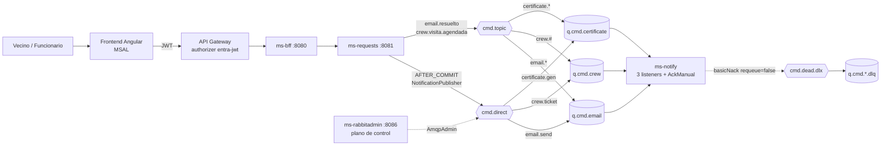
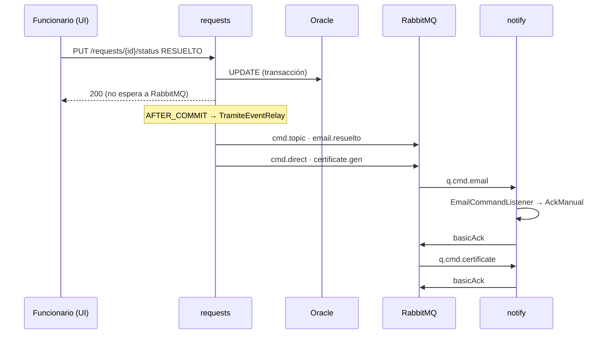

# Super guía — Prueba 2 (EP3 + EP4) · BarrioDigital con RabbitMQ

Todo lo necesario para **entender, defender y demostrar** la Prueba 2: cómo te evalúan, los conceptos, el código
real con su explicación, cómo validar cada cosa en vivo y las preguntas que pueden hacer. El código que aparece aquí
está copiado de `main` al 19-10-2026; donde se recortó, dice `// ...`.

| Si tienes… | Lee |
|---|---|
| 10 minutos | [§1 Cómo te evalúan](#1-cómo-te-evalúan) y [§9 Chuleta](#9-chuleta-de-una-página) |
| 1 hora | §1, §2, §3 y las secciones *"Qué decir"* de §4 |
| Toda la tarde | Todo, y después correr la [§5 Demo](#5-la-demo-de-ep4-paso-a-paso) completa contra el sistema |

Documentos hermanos: el estado y la matriz en [Cumplimiento-Prueba2.md](Cumplimiento-Prueba2.md), el guion
cronometrado en [Guion-Presentacion-Prueba2.md](Guion-Presentacion-Prueba2.md), los enlaces línea a línea en
[Guia-Validacion-Rubrica.md](Guia-Validacion-Rubrica.md) y el porqué de cada decisión en
[Justificacion-Mensajeria.md](Justificacion-Mensajeria.md).

---

## Índice

1. [Cómo te evalúan](#1-cómo-te-evalúan)
2. [El sistema en una página](#2-el-sistema-en-una-página)
3. [Conceptos que tienes que dominar](#3-conceptos-que-tienes-que-dominar)
4. [Los 9 indicadores, con su código](#4-los-9-indicadores-con-su-código)
5. [La demo de EP4 paso a paso](#5-la-demo-de-ep4-paso-a-paso)
6. [Banco de preguntas](#6-banco-de-preguntas)
7. [Trampas: lo que no hay que decir](#7-trampas-lo-que-no-hay-que-decir)
8. [Checklist del día](#8-checklist-del-día)
9. [Chuleta de una página](#9-chuleta-de-una-página)

---

## 1. Cómo te evalúan

### Dos evaluaciones, la misma pauta

| | **EP3 — Encargo** | **EP4 — Presentación** |
|---|---|---|
| Peso en el ramo | 12% | **18%** |
| Modalidad | Parejas | **Individual**, aunque se presenta en grupo |
| Qué se entrega | Código en GitHub | Presentación de **5 a 10 minutos** + preguntas |
| Indicadores 1–8 | Iguales en las dos | Iguales en las dos |
| Indicador 9 | Matriz: lo **implementado** con evidencia | Matriz: lo **demostrado en vivo** |

En EP4 *"cada estudiante fundamenta la propuesta"*: **te pueden preguntar de cualquier parte**, no solo de la que
programaste.

### Los 9 indicadores y dónde están los puntos

| # | Indicador | Peso | Dónde se cumple |
|---|---|---|---|
| 1 | Nombres centralizados | 10% | `application.yml` + `RabbitProperties` (notify, requests) |
| 2 | Beans `Queue`/`Exchange`/`Binding` por caso de uso | 10% | `notify/amqp/RabbitTopologyConfig` |
| 3 | Configuración separada de la lógica de negocio | 8% | `TramiteService` → evento → `TramiteEventRelay` → `NotificationPublisher` |
| 4 | `@RabbitListener` agrupados por dominio | 12% | `notify/amqp/listener/` (3 clases) |
| 5 | **ACK explícito y manejo de errores** | **16%** | `notify/amqp/AckManual` |
| 6 | Administrador con API REST | 10% | `rabbitadmin/web/*Controller` |
| 7 | `RabbitAdminService` | 8% | `rabbitadmin/service/RabbitAdminService` |
| 8 | Validación de entrada | 6% | `rabbitadmin/web/AdminDtos` + `ApiExceptionHandler` |
| 9 | **Matriz de funcionalidades** | **20%** | `Cumplimiento-Prueba2.md`: **17/17** |

El indicador 5 (16%), el administrador (6 + 7 + 8 = 24%) y la matriz (20%) son **el 60% de la nota**. Ahí va el
tiempo de estudio.

### Tramos

Cada indicador se puntúa con 100 / 80 / 60 / 30 / 0. El nivel 100 de los indicadores 1 al 8 pide **"todos"**:
todos los nombres centralizados, todos los consumidores con ACK explícito, todos los parámetros validados. Un solo
caso suelto baja a 80.

La matriz (9) se calcula como *funcionalidades operativas ÷ alcance × 100*. Las **parciales no cuentan**, y en EP4
**lo que no se demuestra tampoco cuenta**.

| % de funcionalidades | Puntaje del indicador 9 |
|---|---|
| ≥ 90% | 100% |
| 72–89% | 80% |
| 54–71% | 60% |
| 27–53% | 30% |

Nuestro alcance declarado es **el sistema con mensajería RabbitMQ: 17 funcionalidades**, las 17 operativas. Si
una no sale en la demo, quedan 16/17 = 94% y se sigue en el tramo de 100. Con dos fallidas se baja a 80.

### Los 11 ítems que hay que mostrar en EP4

| # | Ítem | Tema |
|---|---|---|
| 1–4 | API Manager: instancia, configuración, el frontend lo usa, valida JWT | AWS API Gateway |
| 5–6 | Tenant IDaaS con usuarios; login OAuth 2.0 / OIDC con JWT | Entra ID + MSAL |
| 7 | Backend y frontend desplegados e integrados | `ec2-apps` |
| **8** | **2 nodos RabbitMQ en clúster** | `ec2-mq` |
| **9** | **3 colas con sus DLQ funcionando** | Management UI |
| **10** | **Exchanges direct y topic** | Management UI |
| **11** | **docker-compose en la nube levantando RabbitMQ** | `mq/compose.yml` |

Con 11 ítems en 5–10 minutos, el presupuesto es de **30 a 50 segundos por ítem**. Por eso existe el guion.

### Requisitos generales del encargo

Además de los indicadores, el encargo exige un piso: que el backend compile y pase pruebas básicas, que el
frontend compile y tenga vistas funcionales, la DB cloud con entidades y repositorios, el filtro JWT en el backend,
el login IDaaS en el frontend y `.gitignore` correctos. Todo eso está verificado en
[Cumplimiento §Verificación por capas](Cumplimiento-Prueba2.md#verificación-por-capas).

---

## 2. El sistema en una página



| Pieza | Dónde corre | Rol en esta prueba |
|---|---|---|
| `ms-barriodigital-requests` | `ec2-apps` | **Productor**: publica un comando cuando un trámite cambia de estado |
| `ms-barriodigital-notify` | `ec2-apps` | **Consumidor** y **dueño de la topología**: declara exchanges, colas y bindings y procesa los comandos |
| `ms-barriodigital-rabbitadmin` | `ec2-apps`, puerto 8086 | **Administrador** (plano de control): API REST para crear y borrar colas, exchanges y bindings |
| Clúster RabbitMQ | `ec2-mq`: `rabbitmq1` (5672) y `rabbitmq2` (5673) | 2 nodos, colas **quorum** replicadas |

### El recorrido de un trámite



| Estado nuevo | Comandos que salen | Exchange · routing key |
|---|---|---|
| (creación) | certificado "comprobante de ingreso" | `cmd.direct` · `certificate.gen` |
| `ADMITIDO` | email `ADMITIDO` | `cmd.direct` · `email.send` |
| `EN_TERRENO` | email `VISITA_AGENDADA` + ticket a la cuadrilla | `cmd.direct` · `email.send` y **`cmd.topic` · `crew.visita.agendada`** |
| `RESUELTO` | email `RESUELTO` + certificado | **`cmd.topic` · `email.resuelto`** y `cmd.direct` · `certificate.gen` |

---

## 3. Conceptos que tienes que dominar

| Concepto | Qué es | Cómo se ve en BarrioDigital |
|---|---|---|
| **Productor / consumidor** | Quien publica mensajes y quien los procesa; no se conocen entre sí | `requests` publica, `notify` consume |
| **Exchange** | El "cartero": recibe del productor y decide a qué colas copia el mensaje. El productor **nunca** publica directo a una cola | `cmd.direct`, `cmd.topic`, `cmd.dead.dlx` |
| **Binding** | Regla que une una cola a un exchange con una clave o patrón | `q.cmd.email` ← `cmd.topic` con `email.*` |
| **Routing key** | Etiqueta del mensaje que el exchange compara con los bindings | `email.send`, `email.resuelto` |
| **Exchange `direct`** | Entrega si la routing key es **exactamente igual** al binding | `email.send` → solo `q.cmd.email` |
| **Exchange `topic`** | Entrega por **patrón** de palabras separadas por punto: `*` = **exactamente una** palabra, `#` = **cero o más** | `email.resuelto` calza con `email.*`; `crew.visita.agendada` calza con `crew.#` pero **no** con `crew.*` |
| **Cola durable** | Sobrevive al reinicio del broker | Todas |
| **Cola quorum** | Cola replicada con **Raft** entre nodos; escribe solo si la **mayoría** confirma | Las 6. Con 2 nodos la mayoría es 2: si cae uno, la cola queda indisponible |
| **DLX / DLQ** | *Dead Letter Exchange*: adonde va un mensaje rechazado. *Dead Letter Queue*: la cola que lo guarda para revisarlo | `x-dead-letter-exchange=cmd.dead.dlx` → `q.cmd.*.dlq` |
| **`x-death`** | Header que RabbitMQ agrega al dead-letterear: motivo (`rejected`), cola y exchange de origen, cuántas veces | Se ve en *Get messages* de la DLQ |
| **ACK** | El consumidor confirma "procesado, bórralo" | `channel.basicAck(tag, false)` |
| **NACK** | El consumidor dice "falló": con `requeue=true` vuelve a la cola; con `false` va al DLX | `channel.basicNack(tag, false, requeue)` |
| **ACK automático vs manual** | Automático: Spring confirma solo si el método no lanza excepción. Manual: **el código decide** | `acknowledge-mode: manual` |
| **`deliveryTag`** | Número de la entrega dentro del canal; es lo que se confirma | `@Header(AmqpHeaders.DELIVERY_TAG) long tag` |
| **`x-delivery-count`** | Header que la **cola quorum** agrega en cada reentrega; sirve para contar intentos sin guardar estado | `@Header("x-delivery-count") Number entregas` |
| **At-least-once** | RabbitMQ puede entregar un mensaje más de una vez (p. ej. si el consumidor muere antes del ACK) | Por eso hay idempotencia |
| **Idempotencia** | Procesar dos veces el mismo mensaje da el mismo resultado que una | `ProcessedEventsGuard` por `eventId` |
| **Error recuperable / permanente** | Recuperable: reintentar puede funcionar (timeout). Permanente: siempre fallará (payload malo) | `RuntimeException` vs `ComandoNoRecuperableException` |
| **Clúster RabbitMQ** | Varios nodos que comparten metadatos; se unen con la misma **Erlang cookie** y *peer discovery* | `rabbitmq.conf` con `classic_config` |
| **Plano de datos / de control** | Datos: mover mensajes. Control: administrar la topología | `notify` es datos; `rabbitadmin` es control, en otro proceso |
| **`@TransactionalEventListener(AFTER_COMMIT)`** | Ejecuta el listener **solo si la transacción hizo commit** | No se notifica un cambio que después se revierte |
| **`@ConfigurationProperties`** | Liga un bloque del YAML a una clase tipada | `RabbitProperties` |
| **`AmqpAdmin` / `RabbitAdmin`** | API de Spring para declarar y borrar colas, exchanges y bindings | `notify` (vía beans) y `rabbitadmin` (vía REST) |

---

## 4. Los 9 indicadores, con su código

Cada indicador trae cinco partes: **qué pide el 100%**, **cómo lo cumplimos** (con el código), **qué decir**,
**cómo validarlo** y **la pregunta trampa**.

### Indicador 1 — Nombres centralizados (10%)

**El 100% pide** que todos los nombres de colas, exchanges y bindings estén en `application.yml` o en una única
clase de configuración, **sin valores sueltos** en el código y organizados igual en todos los microservicios.

**Cómo lo cumplimos.** Un bloque `barriodigital.rabbitmq` en el YAML, ligado a un `record` tipado. El código nunca
escribe un nombre; siempre lo lee.

`ms-barriodigital-notify/src/main/resources/application.yml`
```yaml
barriodigital:
  rabbitmq:
    # entregas maximas de un comando con error recuperable antes de mandarlo a la DLQ
    max-intentos: 3
    exchanges:
      direct: cmd.direct
      topic: cmd.topic
      dead-letter: cmd.dead.dlx
    colas:
      email: q.cmd.email
      email-dlq: q.cmd.email.dlq
      crew: q.cmd.crew
      # ...
    routing-keys:
      email-send: email.send
      email-topic: "email.*"
      email-dlq: email.dlq
      # ...
```

`notify/amqp/RabbitProperties.java` (la misma clase en `requests`)
```java
@ConfigurationProperties("barriodigital.rabbitmq")
public record RabbitProperties(Exchanges exchanges, Colas colas, RoutingKeys routingKeys) {

    public record Exchanges(String direct, String topic, String deadLetter) {}

    public record Colas(String email, String emailDlq,
                        String crew, String crewDlq,
                        String certificate, String certificateDlq) {}

    public record RoutingKeys(String emailSend, String emailTopic, String emailDlq, /* ... */) {}
}
```

Hasta la anotación del listener lee el YAML:
```java
@RabbitListener(queues = "${barriodigital.rabbitmq.colas.email}")
```

**Qué decir:** *"`q.cmd.email` aparece escrito una sola vez en todo el código fuente: en el YAML. Los dos
microservicios usan el mismo namespace y la misma clase. Cambiar un nombre es editar un archivo, sin recompilar."*

**Cómo validarlo:**
```bash
# en notify y en requests: no devuelve nada
grep -rnE '"(q\.cmd|cmd\.|email\.|crew\.|certificate\.)' src/main
```

**Pregunta trampa:** *"¿Y el `type` del mensaje, `email.send`, no es un literal?"* → No: se toma de
`props.routingKeys().emailSend()`. El tipo de comando **es** su routing key canónica.

---

### Indicador 2 — Beans `Queue`, `Exchange` y `Binding` por caso de uso (10%)

**El 100% pide** que clases de configuración declaren los beans de cada caso de uso, y que cada ruta esté
identificada y documentada en el código.

**Cómo lo cumplimos.** Tres casos de uso del Caso §8 (email, cuadrilla, certificado). Cada uno tiene **cola + DLQ +
binding direct + binding topic + binding a la DLQ**. En total son **3 exchanges, 6 colas y 9 bindings**, todos
declarados en `notify/amqp/RabbitTopologyConfig.java`.

```java
/**
 * <p>Rutas (los nombres reales estan en application.yml; aqui van con su valor por defecto):
 * <pre>
 *  productor (requests)                        exchange      binding          cola
 *  notificarEmail     ADMITIDO, VISITA_AGENDADA cmd.direct    email.send    -> q.cmd.email
 *  difundirResuelto   RESUELTO                  cmd.topic     email.*       -> q.cmd.email
 *  difundirVisitaAgendada EN_TERRENO            cmd.topic     crew.#        -> q.cmd.crew
 *  generarCertificado creacion, RESUELTO        cmd.direct    certificate.gen -> q.cmd.certificate
 *  rechazo (basicNack requeue=false) de q.cmd.X cmd.dead.dlx  X.dlq         -> q.cmd.X.dlq
 * </pre>
 */
@Configuration
@EnableConfigurationProperties(RabbitProperties.class)
public class RabbitTopologyConfig {

    @Bean
    TopicExchange cmdTopicExchange() {
        return new TopicExchange(p.exchanges().topic(), true, false);   // durable, sin auto-delete
    }

    private Queue cola(String nombre, String dlqRoutingKey) {
        return QueueBuilder.durable(nombre)
                .quorum()                                                // replicada en los 2 nodos
                .withArgument("x-dead-letter-exchange", p.exchanges().deadLetter())
                .withArgument("x-dead-letter-routing-key", dlqRoutingKey)
                .build();
    }

    // ---- email: q.cmd.email <- cmd.direct 'email.send' y cmd.topic 'email.*'; rechazos -> ... ----
    @Bean Queue qCmdEmail()      { return cola(p.colas().email(), p.routingKeys().emailDlq()); }
    @Bean Queue qCmdEmailDlq()   { return dlq(p.colas().emailDlq()); }
    @Bean Binding bindEmailDirect() { return BindingBuilder.bind(qCmdEmail()).to(cmdDirectExchange()).with(p.routingKeys().emailSend()); }
    @Bean Binding bindEmailTopic()  { return BindingBuilder.bind(qCmdEmail()).to(cmdTopicExchange()).with(p.routingKeys().emailTopic()); }
    @Bean Binding bindEmailDlq()    { return BindingBuilder.bind(qCmdEmailDlq()).to(cmdDeadLetterExchange()).with(p.routingKeys().emailDlq()); }
    // ... crew y certificate, igual
}
```

**Por qué funciona:** Spring Boot crea un `RabbitAdmin` que, al conectarse, **declara en el broker todos los beans**
`Queue`, `Exchange` y `Binding`. La declaración es idempotente: si ya existe igual, no pasa nada.

**Qué decir:** *"`notify` es el dueño de la topología: la declara en código y la recrea en cada arranque. Cada cola
nace con su DLX configurado, así que un rechazo tiene a dónde ir sin código extra."*

**Cómo validarlo:**
```bash
ssh mq
cd ~/mq && docker compose exec rabbitmq1 rabbitmqctl list_queues name type consumers messages
# 6 colas tipo quorum; las 3 principales con 1 consumidor
docker compose exec rabbitmq1 rabbitmqctl list_bindings source_name destination_name routing_key
```

**Pregunta trampa:** *"¿Si borro `q.cmd.email` desde el administrador, qué pasa?"* → Se borra, pero **reaparece**
cuando `notify` reinicia, porque la topología base es código. El administrador es para lo operativo: crear colas
nuevas, purgar, reparar.

---

### Indicador 3 — Configuración aislada de la lógica de negocio (8%)

**El 100% pide** que la configuración de mensajería esté aislada en clases propias, que los servicios de negocio
solo usen componentes ya configurados y que no haya configuración en controladores ni servicios de dominio.

**Cómo lo cumplimos.** Son tres capas, y solo la última sabe que existe RabbitMQ.

**1. El servicio de dominio** publica un evento de Spring; no conoce RabbitMQ (`requests/service/TramiteService.java`):
```java
@Transactional
public Tramite cambiarEstado(Long id, EstadoTramite nuevo, String funcionario, String bearer) {
    Tramite tramite = obtener(id);
    // ... valida cupo si corresponde
    EstadoTramite anterior = tramite.getEstado();
    tramite.cambiarEstado(nuevo, funcionario);
    events.publishEvent(new TramiteEstadoCambiadoEvent(tramite, anterior, funcionario));
    return tramite;
}
```

**2. El relay** decide **qué comando** corresponde, después del commit (`requests/service/event/TramiteEventRelay.java`):
```java
@Async("eventRelayExecutor")
@TransactionalEventListener(phase = TransactionPhase.AFTER_COMMIT)
public void alCambiarEstado(TramiteEstadoCambiadoEvent evt) {
    Tramite t = evt.tramite();
    publicarSinRomper("tramite " + t.getId() + " -> " + t.getEstado(), () -> {
        events.publicar(t, evt.estadoAnterior().name(), evt.usuario());   // Kafka
        switch (t.getEstado()) {
            case ADMITIDO -> notifications.notificarEmail(t.getId(), "ADMITIDO");
            case EN_TERRENO -> {
                notifications.notificarEmail(t.getId(), "VISITA_AGENDADA");
                notifications.difundirVisitaAgendada(t.getId(), t.getDireccion());
            }
            case RESUELTO -> {
                notifications.difundirResuelto(t.getId());
                notifications.generarCertificado(t.getId(), "certificado de resolucion");
            }
            default -> { /* INGRESADO, EN_GESTION, RECHAZADO: sin comando */ }
        }
    });
}
```

**3. El publisher**, el único que conoce exchanges y routing keys (`requests/amqp/NotificationPublisher.java`):
```java
/** Difunde por cmd.topic que el tramite quedo resuelto (cae en email.*). */
public void difundirResuelto(Long tramiteId) {
    publicar(props.exchanges().topic(), props.routingKeys().emailSend(), props.routingKeys().emailResuelto(), Map.of(
            "tramiteId", tramiteId,
            "tipoNotificacion", "RESUELTO"));
}

private void publicar(String exchange, String tipo, String routingKey, Map<String, Object> data) {
    var envelope = new CommandEnvelope(
            tipo, UUID.randomUUID().toString(), Instant.now(),      // eventId único → idempotencia
            UUID.randomUUID().toString(), String.valueOf(data.get("tramiteId")), data);
    rabbit.convertAndSend(exchange, routingKey, envelope);           // el ÚNICO convertAndSend
}
```

**Qué decir:** *"El servicio de trámites no sabe que RabbitMQ existe: publica un evento de dominio. El relay
traduce el evento a comandos de negocio (`notificarEmail`, `difundirResuelto`), y solo el publisher sabe a qué
exchange va cada uno. Por eso agregar RabbitMQ no tocó la lógica existente, que es justo lo que pide el encargo."*

**Cómo validarlo:**
```bash
# en requests: 0 y 0
grep -ci "amqp\|rabbit" src/main/java/cl/duoc/barriodigital/requests/service/TramiteService.java \
                        src/main/java/cl/duoc/barriodigital/requests/web/TramiteController.java
```

**Preguntas trampa**
- *"¿Por qué `AFTER_COMMIT`?"* → Si se publicara dentro de la transacción y después hiciera rollback, el vecino
  recibiría un aviso de algo que no pasó.
- *"¿Y si RabbitMQ está caído en ese momento?"* → El relay es `@Async` y captura la excepción (`publicarSinRomper`):
  el usuario recibe su 200 porque la BD ya hizo commit, y el fallo queda en el log. Es entrega *at-most-once*, una
  limitación declarada en el código. La solución completa es un **outbox transaccional**.

---

### Indicador 4 — Consumidores con `@RabbitListener` agrupados por dominio (12%)

**El 100% pide** que todos los consumidores usen `@RabbitListener`, organizados por dominio funcional, con una
estructura fácil de mantener.

**Cómo lo cumplimos.** Una clase por dominio en `notify/amqp/listener/`: `EmailCommandListener`,
`CrewCommandListener` y `CertificateCommandListener`. Cada una tiene una cola, valida su payload y delega la
decisión de ACK.

`notify/amqp/listener/EmailCommandListener.java`
```java
@Component
public class EmailCommandListener {

    private final AckManual ack;

    @RabbitListener(queues = "${barriodigital.rabbitmq.colas.email}")
    public void email(CommandEnvelope cmd, Channel channel,
                      @Header(AmqpHeaders.DELIVERY_TAG) long tag,
                      @Header(name = "x-delivery-count", required = false) Number entregas,
                      @Header(AmqpHeaders.CONSUMER_QUEUE) String cola) throws IOException {
        ack.procesar(cmd, channel, tag, entregas, cola, () -> {
            AckManual.exigir(cmd, "tramiteId", "tipoNotificacion");      // si falta → error permanente
            log.info("[EMAIL/PUSH] tramite={} tipo={} -> vecino notificado",
                    cmd.data().get("tramiteId"), cmd.data().get("tipoNotificacion"));
        });
    }
}
```

**Qué decir:** *"Antes los tres consumidores estaban en una sola clase, que es justo el nivel 60% de la pauta. Ahora
hay una por dominio. La lógica que se repetía —la decisión de ACK— está en un solo componente, `AckManual`, así que
cada listener solo dice qué hace y qué campos exige."*

**Cómo validarlo:** Management UI → *Queues* → cada cola de trabajo tiene **1 consumidor**. Al publicar, el log
muestra la clase de su dominio: `EmailCommandListener : [EMAIL/PUSH]…`, `CrewCommandListener : [CUADRILLA]…`.

**Pregunta trampa:** *"¿Por qué no un solo listener que lea el `type`?"* → Porque mezcla dominios en una clase
(nivel 60%) y porque con una cola por dominio cada uno escala, falla y se monitorea por separado.

---

### Indicador 5 — ACK explícito y manejo de errores (16%) ★

**El 100% pide** que **cada** consumidor gestione el ACK de forma explícita, con rutas diferenciadas y decisiones
claras entre **reintentos, NACK y DLQ**, y la lógica de error documentada y consistente. Ojo con el nivel 60%,
que dice *"ACK automáticos o parciales"*: es lo que teníamos antes.

**1. Se apaga el ACK automático** (`notify/application.yml`):
```yaml
spring:
  rabbitmq:
    listener:
      simple:
        # ACK manual (ver AckManual): cada listener decide ack / nack-requeue / nack-DLQ.
        # Sin requeue por defecto: un rechazo no declarado va a la DLQ, nunca en bucle.
        acknowledge-mode: manual
        default-requeue-rejected: false
```

**2. La clasificación del error es explícita** (`notify/amqp/ComandoNoRecuperableException.java`):
```java
/**
 * Error que no se arregla reintentando (payload sin campos, comando mal formado):
 * el listener lo manda directo a la DLQ con basicNack(requeue=false), sin gastar reintentos.
 * Cualquier otra excepcion se considera recuperable (proveedor caido, timeout).
 */
public class ComandoNoRecuperableException extends RuntimeException { /* ... */ }
```

**3. La decisión, en un solo lugar** (`notify/amqp/AckManual.java`). Este es el código más importante de la prueba:
```java
public void procesar(CommandEnvelope cmd, Channel channel, long tag, Number entregas,
                     String cola, Runnable accion) throws IOException {
    String eventId = cmd.eventId();
    if (eventId == null) {                                              // ① sin id: no se puede deduplicar
        log.error("NACK->DLQ cola={} eventId=null motivo=comando sin eventId", cola);
        channel.basicNack(tag, false, false);
        return;
    }
    if (!guard.esNuevo(eventId)) {                                      // ② duplicado: ya está procesado
        log.info("{} duplicado, se ignora (eventId={})", cmd.type(), eventId);
        channel.basicAck(tag, false);
        return;
    }
    try {
        simularFallaSiSePide(cmd);                                      //    (solo para la demo, ver abajo)
        accion.run();
    } catch (ComandoNoRecuperableException e) {                         // ③ permanente: DLQ sin reintentar
        log.error("NACK->DLQ cola={} eventId={} motivo={}", cola, eventId, e.getMessage());
        channel.basicNack(tag, false, false);
        return;
    } catch (RuntimeException e) {                                      // ④ recuperable: reintentar
        int intento = (entregas == null ? 0 : entregas.intValue()) + 1;
        if (intento >= maxIntentos) {                                   //    ④a agotado → DLQ
            log.error("NACK->DLQ cola={} eventId={} motivo=reintentos agotados ({}/{}): {}",
                    cola, eventId, intento, maxIntentos, e.toString());
            channel.basicNack(tag, false, false);
        } else {                                                        //    ④b → de vuelta a la cola
            guard.liberar(eventId); // el reintento no debe tomarse por duplicado
            log.error("NACK->requeue cola={} eventId={} motivo=error recuperable, intento {}/{}: {}",
                    cola, eventId, intento, maxIntentos, e.toString());
            channel.basicNack(tag, false, true);
        }
        return;
    }
    channel.basicAck(tag, false);                                       // ⑤ éxito
}
```

| Ruta | Condición | Acción | Termina en |
|---|---|---|---|
| ① | Sin `eventId` | `basicNack(requeue=false)` + `log.error` | DLQ |
| ② | `eventId` ya visto | `basicAck` | Descartado (ya se procesó) |
| ③ | `ComandoNoRecuperableException` | `basicNack(requeue=false)` + `log.error` | DLQ, **sin reintentos** |
| ④b | Otra excepción, intento < 3 | `basicNack(requeue=true)` + `log.error` | La cola, se reintenta |
| ④a | Otra excepción, intento = 3 | `basicNack(requeue=false)` + `log.error` | DLQ |
| ⑤ | Todo bien | `basicAck` | Fin |
| — | El mensaje no se puede convertir (JSON roto) | Spring lo rechaza sin requeue antes de llegar al listener (`WARN`) | DLQ |

**4. La idempotencia** (`notify/amqp/ProcessedEventsGuard.java`):
```java
// ponytail: dedupe en memoria de una sola instancia. Si notify-svc escala a
// mas de una replica, esto deja de servir y hay que pasar a una tabla/Redis
// con TTL por eventId.
@Component
public class ProcessedEventsGuard {
    private final Set<String> vistos = ConcurrentHashMap.newKeySet();

    public boolean esNuevo(String eventId) { return vistos.add(eventId); }
    public void liberar(String eventId)    { vistos.remove(eventId); }
}
```

**5. La falla inyectable de la demo.** Los consumidores simulan el envío con un log y nunca fallan solos, así que la
ruta ④ no se podría mostrar en vivo. Con `"simularFalla": true` en el payload se comportan como un proveedor caído:
```java
private static void simularFallaSiSePide(CommandEnvelope cmd) {
    if (cmd.data() != null && Boolean.TRUE.equals(cmd.data().get("simularFalla"))) {
        throw new IllegalStateException("falla simulada del proveedor (simularFalla=true)");
    }
}
```

**6. Un test por rama** (`notify/.../AckManualTest.java`), con el `Channel` mockeado y sin broker:
```java
@Test
void error_recuperable_con_reintentos_agotados_va_a_la_dlq() throws IOException {
    // x-delivery-count=2 -> esta es la 3a entrega = max-intentos
    ack.procesar(cmd("e4"), channel, TAG, 2L, COLA, () -> { throw new IllegalStateException("timeout"); });

    verify(channel).basicNack(TAG, false, false);
}
```

**Qué decir (memorizar):** *"El ACK lo decide el código, no Spring. Hay tres salidas. Éxito o duplicado, ACK. Error
permanente, como un payload sin campos, va directo a la DLQ, porque reintentarlo daría el mismo error. Error
recuperable, como un proveedor caído, se reencola hasta tres entregas, contadas con el `x-delivery-count` que pone
la cola quorum, y si se agotan va a la DLQ. Cada salida a la DLQ deja un `log.error` con el `eventId`, la cola y el
motivo, que es lo que pide el encargo: DLQ **y** logs."*

**Cómo validarlo en vivo:** ver la [§5, paso C](#c-demo-de-falla-ack-nack-y-dlq-indicador-5). Los 5 casos
están verificados el 18-10, incluida la secuencia `intento 1/3` → `2/3` → `reintentos agotados (3/3)`.

**Preguntas trampa**
- *"¿Por qué no usar el `retry` de Spring?"* → Reintenta dentro del mismo hilo y oculta la decisión. Con ACK manual
  se lee en el código, y el que cuenta las entregas es el broker.
- *"¿Por qué liberar el `eventId` al reencolar?"* → Si no, el reintento se vería como duplicado y se haría ACK sin
  procesar. Se perdería el mensaje.
- *"¿Para qué `default-requeue-rejected: false`?"* → Red de seguridad: cualquier rechazo que no pase por
  `AckManual` va a la DLQ y nunca queda en un bucle infinito.
- *"¿El reintento tiene espera?"* → No, es inmediato. Sirve para clasificar errores; para fallos transitorios
  reales se agregaría una cola de espera con TTL. Está declarado como brecha.
- *"¿`simularFalla` no es un hack?"* → Es inyección de fallas para demostrar la ruta de reintentos, marcada como tal
  en el código. Sin ella la ruta existiría, pero solo se podría ver en los tests.

---

### Indicador 6 — Administrador con API REST (10%)

**El 100% pide** una API REST clara y coherente, con rutas, verbos y recursos bien definidos, buenas prácticas y
documentación.

**Cómo lo cumplimos.** `ms-barriodigital-rabbitadmin`, puerto 8086, sin base de datos. Hay un controlador por
recurso: colas, exchanges y bindings.

| Verbo | Ruta | Respuesta |
|---|---|---|
| `POST` | `/admin/queues` | 201 + `{"nombre": …}` |
| `GET` | `/admin/queues[?names=a,b]` | 200 + mensajes y consumidores por cola |
| `DELETE` | `/admin/queues/{nombre}` | 204, o 404 si no existe |
| `POST` | `/admin/queues/{nombre}/purge` | 200 + cuántos mensajes descartó |
| `POST` / `DELETE` | `/admin/exchanges[/{nombre}]` | 201 / 204 |
| `POST` / `DELETE` | `/admin/bindings` | 201 / 204 |

`rabbitadmin/web/QueueAdminController.java`
```java
@Validated
@RestController
@RequestMapping("/admin/queues")
public class QueueAdminController {

    private final RabbitAdminService service;

    @PostMapping
    @ResponseStatus(HttpStatus.CREATED)
    public ColaCreadaResponse crear(@Valid @RequestBody CrearColaRequest req) {
        return new ColaCreadaResponse(service.crearCola(
                req.nombre(), req.esDurable(), req.deadLetterExchange(), req.deadLetterRoutingKey()));
    }

    @DeleteMapping("/{nombre}")
    @ResponseStatus(HttpStatus.NO_CONTENT)
    public void eliminar(@PathVariable @Pattern(regexp = NOMBRE_VALIDO, message = "...") String nombre) {
        service.eliminarCola(nombre);
    }
    // ... GET, POST /{nombre}/purge
}
```

Seguridad, en un solo lugar (`rabbitadmin/config/SecurityConfig.java`):
```java
.authorizeHttpRequests(auth -> auth
    .requestMatchers("/actuator/health").permitAll()
    .requestMatchers("/admin/**").hasRole("Admin")
    .anyRequest().authenticated())
```

**Qué decir:** *"Es un microservicio aparte porque es plano de control: crear y borrar colas no puede vivir en el
mismo proceso que procesa las notificaciones. Si escalo `notify` a tres réplicas, tendría tres APIs capaces de
borrar la misma cola. Recursos en plural, verbos con su significado, códigos correctos y todo `/admin/**` exige rol
Admin."*

**Cómo validarlo:** ver la [§5, paso D](#d-el-administrador-indicadores-6-7-y-8). El puerto 8086 no está abierto en
`sg-apps`, así que se llama desde `ec2-apps` con un token de Admin.

**Pregunta trampa:** *"¿Por qué purgar es `POST` y no `DELETE /queues/{n}/messages`?"* → Las dos son válidas;
purgar es una **acción** sobre la cola, no la eliminación de un recurso con identidad. Lo importante es que sea
consistente y esté documentado en el README.

---

### Indicador 7 — `RabbitAdminService` encapsula la lógica (8%)

**El 100% pide** que la creación, actualización y eliminación estén en un servicio dedicado, y que los
controladores llamen métodos de alto nivel **sin conocer RabbitMQ**.

`rabbitadmin/service/RabbitAdminService.java` es el único lugar que usa `AmqpAdmin`, `QueueBuilder` y
`ExchangeBuilder`:
```java
/** Unico punto del servicio que conoce RabbitMQ. Los controladores hablan de nombres, tipos y routing keys. */
@Service
public class RabbitAdminService {

    public String crearCola(String nombre, boolean durable,
                            String deadLetterExchange, String deadLetterRoutingKey) {
        QueueBuilder builder = durable ? QueueBuilder.durable(nombre) : QueueBuilder.nonDurable(nombre);
        if (tieneTexto(deadLetterExchange)) builder.withArgument("x-dead-letter-exchange", deadLetterExchange);
        if (tieneTexto(deadLetterRoutingKey)) builder.withArgument("x-dead-letter-routing-key", deadLetterRoutingKey);
        return amqpAdmin.declareQueue(builder.build());
    }

    public void eliminarCola(String nombre) {
        if (!amqpAdmin.deleteQueue(nombre)) {
            throw new NoSuchElementException("No existe la cola " + nombre);   // → 404
        }
    }

    public int purgarCola(String nombre) { /* ... */ return amqpAdmin.purgeQueue(nombre); }
    public void crearExchange(String nombre, String tipo) { amqpAdmin.declareExchange(construirExchange(nombre, tipo)); }
    public void crearBinding(String cola, String exchange, String routingKey) { /* ... */ }
    // ... eliminarExchange, eliminarBinding, listar

    /** Datos de una cola, sin exponer tipos de Spring AMQP hacia la capa web. */
    public record InfoCola(String nombre, int mensajes, int consumidores) {}
}
```

**Qué decir:** *"El controlador dice `service.crearCola(nombre, …)` y no sabe qué es un `QueueBuilder`. Ni siquiera
devuelve tipos de Spring AMQP: devuelve `InfoCola`, un record propio."*

**Cómo validarlo:**
```bash
# en rabbitadmin: sin salida, ningún controlador importa AMQP
grep -l "org.springframework.amqp" src/main/java/cl/duoc/barriodigital/rabbitadmin/web/*Controller.java
```

**Pregunta trampa:** *"La pauta dice 'actualización'. ¿Dónde se actualiza una cola?"* → En AMQP una cola **no se
modifica** una vez declarada: redeclararla con otros argumentos es un error del broker (nuestro 409). Las
actualizaciones que existen son purgar y cambiar bindings, y están en el servicio. Cambiar argumentos exige borrar y
crear.

---

### Indicador 8 — Validación de entrada (6%)

**El 100% pide** que se validen **todos** los parámetros con DTO y anotaciones, que no se puedan crear colas con
nombre vacío ni configuraciones inválidas y que los mensajes de error sean claros.

`rabbitadmin/web/AdminDtos.java`
```java
static final String NOMBRE_VALIDO = "^(?!amq\\.)[A-Za-z0-9._:-]+$";
static final String MENSAJE_NOMBRE =
        "solo admite letras, digitos, punto, guion, guion bajo y dos puntos (sin espacios),"
        + " y no puede empezar con 'amq.' (prefijo reservado de RabbitMQ)";

public record CrearColaRequest(
        @NotBlank(message = "el nombre de la cola es obligatorio")
        @Size(max = 255, message = "el nombre no puede superar los 255 caracteres")
        @Pattern(regexp = NOMBRE_VALIDO, message = "el nombre de la cola " + MENSAJE_NOMBRE)
        String nombre,
        Boolean durable,
        @Size(max = 255)
        @Pattern(regexp = NOMBRE_VALIDO, message = "el dead letter exchange " + MENSAJE_NOMBRE)
        String deadLetterExchange,
        @Size(max = 255)
        String deadLetterRoutingKey) { /* ... */ }

public record CrearExchangeRequest(
        @NotBlank(message = "el nombre del exchange es obligatorio") /* ... */ String nombre,
        @NotBlank(message = "el tipo de exchange es obligatorio")
        @Pattern(regexp = "direct|topic|fanout|headers",
                 message = "el tipo debe ser uno de: direct, topic, fanout, headers")
        String tipo) {}
```

Los errores, traducidos a `ProblemDetail` legibles (`rabbitadmin/web/ApiExceptionHandler.java`):
```java
@ExceptionHandler(MethodArgumentNotValidException.class)        // cuerpo inválido
ProblemDetail entradaInvalida(MethodArgumentNotValidException ex) {
    String detalle = ex.getBindingResult().getFieldErrors().stream()
            .map(e -> e.getField() + ": " + e.getDefaultMessage())
            .collect(Collectors.joining("; "));
    return problema(HttpStatus.BAD_REQUEST, "Entrada invalida", detalle);
}

@ExceptionHandler(AmqpException.class)                         // el broker rechazó
ProblemDetail brokerRechazo(AmqpException ex) {
    String causa = NestedExceptionUtils.getMostSpecificCause(ex).getMessage();
    if (causa != null && causa.contains("PRECONDITION_FAILED")) {
        return problema(HttpStatus.CONFLICT, "Configuracion incompatible con la existente",
                "RabbitMQ rechazo la operacion porque ya existe con otros argumentos: " + causa);
    }
    return problema(HttpStatus.BAD_GATEWAY, "Error del broker", "RabbitMQ rechazo la operacion: " + causa);
}
```

| Entrada | Respuesta |
|---|---|
| `{"nombre":""}` | **400** · `nombre: el nombre de la cola es obligatorio` |
| `{"nombre":"cola con espacios"}` | **400** · `… (sin espacios) …` |
| `{"nombre":"amq.mia"}` | **400** · `… no puede empezar con 'amq.' …` |
| exchange `{"tipo":"cuantico"}` | **400** · `el tipo debe ser uno de: direct, topic, fanout, headers` |
| `DELETE /admin/queues/cola!mala` | **400**: el nombre de la ruta también se valida (`@Validated`) |
| `{"nombre":"q.cmd.email"}` (ya existe como quorum con DLX) | **409** con el motivo del broker (`inequivalent arg …`) |

**Qué decir:** *"Un nombre inválido nunca llega al broker: se rechaza con un 400 que dice qué campo falló y por qué.
Y si la configuración choca con lo que ya existe, el 409 trae el motivo exacto que dio RabbitMQ."*

**Cómo validarlo:** 17 tests en `AdminApiTest` (`mvn -B verify`), y en vivo en la [§5, paso D](#d-el-administrador-indicadores-6-7-y-8).

**Pregunta trampa:** *"¿Por qué prohibir `amq.`?"* → RabbitMQ reserva ese prefijo para sus exchanges internos
(`amq.direct`, `amq.topic`…) y niega crearlo con un 403. Mejor rechazarlo antes, con un mensaje claro.

---

### Indicador 9 — Matriz de funcionalidades (20%)

**El 100% pide**, en EP3, **≥ 90%** del alcance implementado y operativo, con estado, componente responsable y
evidencia verificable para cada funcionalidad. En EP4 pide lo mismo, pero **demostrado en vivo**.

**Cómo lo cumplimos.** [Cumplimiento-Prueba2.md, *Indicador 9*](Cumplimiento-Prueba2.md#indicador-9--matriz-de-funcionalidades-20)
tiene 4 tablas, todas con **Estado**, **Componente** y **Evidencia**, y está enlazada desde el README de los 9
repos.

| Bloque | Operativas | Cómo se demuestra |
|---|---|---|
| A. Módulos (trámites, catálogo, notificaciones, reportería, auditoría) | 5/5 | Usar cada pantalla |
| B. Pantallas (`/login`, `/dashboard`, `/requests`, `/catalog`, `/reports`, `/audit`) | 6/6 | Navegar con el rol que corresponde |
| C. Flujos RabbitMQ (email, cuadrilla, certificado) | 3/3 | Log de `notify` al cambiar estados |
| D. Exigencias EP3 (productores y consumidores, DLQ + logs, administrador) | 3/3 | §5 pasos B, C y D |
| **Total** | **17/17** | |

Los tópicos Kafka están listados aparte, **fuera del alcance** de esta prueba (100% RabbitMQ), sin contar.

**Qué decir:** *"La matriz declara el alcance de esta prueba: el sistema con su mensajería RabbitMQ, 17
funcionalidades. Las 17 están operativas, cada una con el componente que la implementa y dónde está la evidencia.
Lo que quedó fuera también está escrito: los tópicos Kafka de la etapa anterior."*

**Pregunta trampa:** *"¿Y Kafka?"* → *"El alcance de esta prueba es RabbitMQ y así lo declara la matriz.
`requests.events` funciona y alimenta Reportería y Auditoría, que sí están en el alcance. `audit.timeline` y los
`*.DLT` están listados como pendientes, a la vista."*

---

## 5. La demo de EP4 paso a paso

El orden y los tiempos están en el [guion](Guion-Presentacion-Prueba2.md); aquí van **los comandos y lo que tiene
que aparecer**. Hay que tener abiertos antes:

| Ventana | Cómo |
|---|---|
| App | `https://dnddhzpvgg.execute-api.us-east-1.amazonaws.com/login` |
| Terminal A: log de notify | `ssh apps` → `cd ~/barriodigital-infra/apps && docker compose logs -f --no-log-prefix notify` |
| Terminal B: túnel | `ssh -L 15672:127.0.0.1:15672 -L 15673:127.0.0.1:15673 mq` |
| Management UI | http://localhost:15672 (nodo 1) y http://localhost:15673 (nodo 2), con el usuario de `~/mq/.env` |
| Consola AWS | API Gateway `dnddhzpvgg` y EC2 |

**Para publicar a mano:** *Exchanges* → elegir el exchange → *Publish message* → *Routing key* →
*Properties*: `content_type` = `application/json` → *Payload*. **Cada `eventId` tiene que ser nuevo** en cada
ensayo, porque `notify` recuerda los que ya vio hasta que se reinicia.

### A. Clúster y docker-compose (ítems 8 y 11)

```bash
ssh mq
cd ~/mq && docker compose ps                                              # rabbitmq1 y rabbitmq2: Up (healthy)
docker compose exec rabbitmq1 rabbitmqctl cluster_status | grep -A3 "Running Nodes"
docker compose exec rabbitmq1 rabbitmq-queues quorum_status q.cmd.email   # miembros en los 2 nodos
```

El código que lo hace posible (`barriodigital-infra/mq/`):
```yaml
# compose.yml
x-rabbit: &rabbit
  image: rabbitmq:3.13-management
  restart: always
  environment:
    RABBITMQ_ERLANG_COOKIE: ${RABBITMQ_ERLANG_COOKIE:?falta o esta vacio en mq/.env}   # misma cookie = mismo clúster
  healthcheck:
    test: ["CMD", "rabbitmq-diagnostics", "-q", "check_running"]
services:
  rabbitmq1:
    <<: *rabbit
    hostname: rabbitmq1
    ports: ["5672:5672", "15672:15672"]
    volumes: [ "./rabbitmq.conf:/etc/rabbitmq/conf.d/20-cluster.conf:ro" ]
  rabbitmq2:
    <<: *rabbit
    hostname: rabbitmq2
    ports: ["5673:5672", "15673:15672"]
    depends_on: { rabbitmq1: { condition: service_healthy } }
```
```ini
# rabbitmq.conf (el mismo archivo en los dos nodos)
cluster_formation.peer_discovery_backend = classic_config
cluster_formation.classic_config.nodes.1 = rabbit@rabbitmq1
cluster_formation.classic_config.nodes.2 = rabbit@rabbitmq2
```

> *"Dos nodos con la misma Erlang cookie y peer discovery declarado: el clúster se forma solo al arrancar, sin
> scripts de join. Las colas son quorum, así que cada mensaje está replicado en los dos nodos."*

### B. Topología y los 3 flujos (ítems 9 y 10, matriz bloque C)

1. *Exchanges*: mostrar `cmd.direct` (direct), `cmd.topic` (topic) y `cmd.dead.dlx`.
2. *Queues*: mostrar las 6, tipo `quorum`. Abrir `q.cmd.email` → *Features*: `DLX: cmd.dead.dlx`, `DLK: email.dlq`.
3. **Flujo real desde la app** (necesita usuarios con rol):

| Acción en la app | En el Terminal A |
|---|---|
| Vecino crea un trámite | `CertificateCommandListener : [CERTIFICADO] PDF generado … motivo=comprobante de ingreso` |
| Funcionario lo pasa a `ADMITIDO` | `EmailCommandListener : [EMAIL/PUSH] … tipo=ADMITIDO` |
| … a `EN_TERRENO` | `[EMAIL/PUSH] … tipo=VISITA_AGENDADA` + `CrewCommandListener : [CUADRILLA] …` (por **topic**) |
| … a `RESUELTO` | `[EMAIL/PUSH] … tipo=RESUELTO` (por **topic**) + `[CERTIFICADO] … certificado de resolucion` |

4. **Plan B sin token:** publicar desde la Management UI.

| Exchange | Routing key | Payload |
|---|---|---|
| `cmd.topic` | `email.resuelto` | `{"type":"email.send","eventId":"demo-1","data":{"tramiteId":1,"tipoNotificacion":"RESUELTO"}}` |
| `cmd.topic` | `crew.visita.agendada` | `{"type":"crew.ticket","eventId":"demo-2","data":{"tramiteId":1,"direccion":"Calle 1"}}` |
| `cmd.direct` | `certificate.gen` | `{"type":"certificate.gen","eventId":"demo-3","data":{"tramiteId":1,"motivo":"certificado de resolucion"}}` |

5. Volver a *Exchanges* → `cmd.topic`: el *message rate* ya no es 0. Eso **demuestra** el ítem 10, además de mostrarlo.

> *"`direct` entrega por coincidencia exacta: `email.send` solo llega a `q.cmd.email`. `topic` entrega por patrón:
> `email.resuelto` calza con `email.*`; `crew.visita.agendada` calza con `crew.#`, porque `#` acepta varias
> palabras y `*` solo una. El productor no sabe quién consume."*

### C. Demo de falla: ACK, NACK y DLQ (indicador 5)

Publicar en `cmd.direct` con routing key `email.send`:

| # | Payload | Terminal A | Broker |
|---|---|---|---|
| 1 Éxito | `{"type":"email.send","eventId":"demo-4","data":{"tramiteId":1,"tipoNotificacion":"ADMITIDO"}}` | `[EMAIL/PUSH] tramite=1 tipo=ADMITIDO` | ACK |
| 2 Duplicado | el mismo, otra vez | `email.send duplicado, se ignora (eventId=demo-4)` | ACK sin reprocesar |
| 3 Permanente | `{"type":"email.send","eventId":"demo-5","data":{"tramiteId":1}}` | `NACK->DLQ cola=q.cmd.email eventId=demo-5 motivo=payload sin 'tipoNotificacion'` | +1 en `q.cmd.email.dlq` |
| 4 Recuperable | `{"type":"email.send","eventId":"demo-6","data":{"tramiteId":1,"tipoNotificacion":"X","simularFalla":true}}` | `NACK->requeue … intento 1/3`, `… intento 2/3`, `NACK->DLQ … reintentos agotados (3/3)` | +1 en la DLQ |

Después: *Queues* → `q.cmd.email.dlq` → *Get messages* con *Ack mode* = **Nack message requeue true** (para no
sacarlos) → el header `x-death` muestra `reason: rejected`, `queue: q.cmd.email` y el exchange de origen.

> Usar el discurso de la [sección *Qué decir* del indicador 5](#indicador-5--ack-explícito-y-manejo-de-errores-16-).

### D. El administrador (indicadores 6, 7 y 8)

Necesita el token de un usuario **Admin**: en la app, DevTools → *Application* → *Local Storage* → la entrada que
contiene `accesstoken` → copiar el campo `secret`.

```bash
ssh apps
T='<access token del Admin>'
A='localhost:8086/admin'
H=(-H "Authorization: Bearer $T" -H 'content-type: application/json')

curl -s -o /dev/null -w "%{http_code}\n" $A/queues                        # 401 sin token
curl -s "${H[@]}" $A/queues                                                 # 200: las 6 colas
curl -s "${H[@]}" -X POST $A/queues -d '{"nombre":"q.demo"}'                # 201
curl -s "${H[@]}" -X POST $A/bindings -d '{"cola":"q.demo","exchange":"cmd.topic","routingKey":"email.*"}'  # 201
# → publicar email.resuelto en cmd.topic: llega a q.cmd.email Y a q.demo (consumidor nuevo sin tocar el productor)
curl -s "${H[@]}" -X POST $A/queues -d '{"nombre":""}'                      # 400 obligatorio
curl -s "${H[@]}" -X POST $A/queues -d '{"nombre":"amq.mia"}'               # 400 prefijo reservado
curl -s "${H[@]}" -X POST $A/queues -d '{"nombre":"q.cmd.email"}'           # 409 configuración incompatible
curl -s "${H[@]}" -X DELETE -w "%{http_code}\n" $A/queues/q.demo            # 204
```

### E. Ítems 1 a 7 (resumen; el detalle está en el guion)

| Ítem | Qué mostrar |
|---|---|
| 1–2 | Consola AWS → API Gateway `dnddhzpvgg` → ruta `ANY /api/{proxy+}` → integración HTTP a `http://<EIP>:8080/api/{proxy}`; ruta `OPTIONS` para CORS |
| 3 | DevTools → *Network*: las llamadas de la app van al Invoke URL del Gateway |
| 4 | `curl -s -o /dev/null -w "%{http_code}" https://dnddhzpvgg.execute-api.us-east-1.amazonaws.com/api/requests` → **401**; desde la app con sesión → 200. Authorizer `entra-jwt` (issuer + audience) |
| 5 | Portal de Entra: el tenant, las App Registrations, los 4 App Roles y los usuarios asignados |
| 6 | Login con popup de Microsoft → access token en https://jwt.ms con `iss` …/v2.0, `aud`, `scp=access_as_user` y `roles` |
| 7 | `ssh apps` → `docker compose ps`: 8 contenedores `Up` |

---

## 6. Banco de preguntas

| Pregunta | Respuesta corta |
|---|---|
| ¿Por qué una cola y no una llamada HTTP a notify? | Desacople temporal: si `notify` está caído, el comando espera en la cola y el trámite no falla. HTTP acoplaría la respuesta al vecino con la disponibilidad del servicio de notificaciones |
| ¿Por qué RabbitMQ **y** Kafka? | Llevan cosas distintas: RabbitMQ, **comandos** con reintento y DLQ por mensaje; Kafka, **hechos** con fan-out y relectura. Kafka no tiene NACK por mensaje |
| ¿Por qué tres exchanges? | `direct` para comandos con destinatario conocido, `topic` para difundir por patrón y poder sumar consumidores, `dead.dlx` para los rechazos |
| ¿Qué diferencia hay entre `*` y `#`? | `*` es exactamente una palabra; `#`, cero o más. `crew.visita.agendada` calza con `crew.#` y **no** con `crew.*` |
| ¿Qué pasa si `notify` muere a mitad de un mensaje? | Sin ACK, RabbitMQ lo reentrega a otro consumidor o cuando vuelva (at-least-once). El `eventId` evita procesarlo dos veces |
| ¿Por qué colas quorum y no clásicas? | Las clásicas viven en un solo nodo: el segundo nodo no tendría copia de nada. Las quorum replican con Raft |
| ¿El clúster tolera que se caiga un nodo? | **No** con 2 nodos: Raft necesita mayoría (2 de 2). Se replica, pero si cae uno la cola queda indisponible. Hacen falta 3 nodos para tolerar la caída |
| ¿Qué hace `RABBITMQ_ADDRESSES`? | Lista los dos nodos (`:5672` y `:5673`): si se cae la conexión con uno, el cliente se reconecta al otro (failover del cliente) |
| ¿Cómo se forma el clúster? | Misma Erlang cookie y peer discovery `classic_config` en `rabbitmq.conf`; `depends_on: service_healthy` ordena el primer arranque |
| ¿Por qué `restart: always`? | Por el ciclo stop/start del Learner Lab: al encenderse la EC2, Docker levanta los contenedores solo |
| ¿Por qué el administrador es un microservicio aparte? | Plano de control vs. plano de datos: privilegios, superficie de red y escalado distintos |
| ¿El administrador está expuesto a Internet? | No: el 8086 no está abierto en `sg-apps`, y además exige JWT con rol Admin |
| ¿Por qué la cola borrada reaparece? | `notify` declara la topología al arrancar. La topología base es código; el administrador es para lo operativo |
| ¿Cómo sabe `notify` cuántas veces se entregó un mensaje? | Por el header `x-delivery-count` que agrega la cola quorum |
| ¿Dónde queda registro de lo que fue a la DLQ? | En dos lugares: el mensaje en la DLQ con su `x-death`, y el `log.error` con `eventId`, cola y motivo |
| ¿Qué pasa si RabbitMQ está caído cuando `requests` publica? | El cambio de estado ya se guardó y el usuario recibe 200; el comando se pierde y queda en el log (at-most-once). Mejora: outbox transaccional |
| ¿La idempotencia funciona con varias réplicas de notify? | No: el registro está en memoria de una instancia. Con réplicas habría que pasarlo a una tabla o a Redis. Está declarado en el código |
| ¿Por qué el `type` del mensaje no cambia entre direct y topic? | El tipo describe **qué** comando es; el exchange describe **cómo** se enruta. `notify` procesa igual un `email.send` venga por donde venga |
| ¿Cómo se prueba sin broker? | Con `Channel` y `AmqpAdmin` mockeados: `AckManualTest`, `CommandListenersTest`, `NotificationPublisherTest`, `AdminApiTest` y `RabbitAdminServiceTest` |
| ¿Qué es el `@Async` del relay? | Que la publicación no bloquee el hilo HTTP: con el broker lento, el usuario no espera ni recibe un 503 |

---

## 7. Trampas: lo que no hay que decir

| No decir | Lo correcto |
|---|---|
| "`email.estado.resuelto` cae en `email.*`" | **Falso**: `*` es una sola palabra. Publicamos `email.resuelto` |
| "El clúster sigue funcionando si se cae un nodo" | Con 2 nodos, la cola quorum queda **indisponible**: hace falta mayoría |
| "Borro la cola y desaparece" | Reaparece cuando `notify` reinicia |
| "Usamos el retry de Spring" | Ya no: el ACK es manual y los intentos se cuentan con `x-delivery-count` |
| "El reintento espera un tiempo" | Es inmediato; es una brecha declarada |
| "La matriz está al 100% del Caso" | Está al 100% **del alcance de la Prueba 2** (RabbitMQ); Kafka está listado fuera |
| Entrar a la Management UI con `guest/guest` | `guest` devuelve 401; el usuario es el de `~/mq/.env` |
| Restringir el 8080 de `sg-apps` "por seguridad" | Rompe el API Gateway (503): la seguridad la pone el JWT, no el Security Group |
| Reusar un `eventId` en la demo | Sale como "duplicado". Usar ids nuevos en cada ensayo |
| Publicar sin `content_type: application/json` | Falla antes del listener (va a la DLQ igual, pero sin pasar por `AckManual`) |

---

## 8. Checklist del día

**La noche anterior**
- [ ] Ensayo cronometrado completo (H5), con reloj: 5 a 10 minutos.
- [ ] Cada uno practica en voz alta el bloque que **no** programó: el administrador y el ACK manual son de los dos.
- [ ] Usuarios de prueba con su rol en Entra (I2) y contraseñas a mano.

**30 minutos antes**
- [ ] Encender el Learner Lab y esperar que las EC2 estén *running*.
- [ ] `https://dnddhzpvgg.execute-api.us-east-1.amazonaws.com/login` → 200.
- [ ] `ssh apps` → `docker compose ps`: 8 contenedores `Up`.
- [ ] `ssh mq` → `docker compose ps`: los 2 nodos `healthy`.
- [ ] Abrir las ventanas de la §5 y loguearse en la Management UI.
- [ ] Copiar el token Admin (dura ~1 hora).
- [ ] Tener listos los payloads de la §5 con **eventIds nuevos**.

**Durante**
- [ ] Seguir el orden del guion; si algo falla, pasar al plan B (publicar desde la UI) sin detenerse.
- [ ] Mostrar el log **y** el broker: la pauta pide DLQ y logs.
- [ ] Cerrar con la matriz: 17/17 y lo que está fuera del alcance.

---

## 9. Chuleta de una página

```text
COLAS          q.cmd.email · q.cmd.crew · q.cmd.certificate  (+ .dlq)   — 6, todas quorum
EXCHANGES      cmd.direct (direct) · cmd.topic (topic) · cmd.dead.dlx (direct)
BINDINGS       9 = 3 direct (email.send, crew.ticket, certificate.gen)
                 + 3 topic (email.*, crew.#, certificate.*)
                 + 3 DLQ (email.dlq, crew.dlq, certificate.dlq)
TOPIC          * = una palabra · # = cero o más · email.resuelto → email.* · crew.visita.agendada → crew.#
ACK            manual · éxito/duplicado → basicAck · permanente → basicNack(false) → DLQ
               recuperable → basicNack(true) hasta 3 entregas (x-delivery-count) → DLQ · todo NACK = log.error
CÓDIGO CLAVE   notify:     amqp/AckManual · amqp/RabbitTopologyConfig · amqp/listener/*
               requests:   amqp/NotificationPublisher · service/event/TramiteEventRelay (AFTER_COMMIT)
               rabbitadmin: service/RabbitAdminService · web/AdminDtos · web/ApiExceptionHandler
ADMIN API      POST/GET /admin/queues · DELETE /admin/queues/{n} · POST /admin/queues/{n}/purge
               POST/DELETE /admin/exchanges · POST/DELETE /admin/bindings · rol Admin · puerto 8086 interno
CLÚSTER        ec2-mq · rabbitmq1 :5672/:15672 · rabbitmq2 :5673/:15673 · classic_config + Erlang cookie
MATRIZ         17/17 (5 módulos + 6 pantallas + 3 flujos + 3 exigencias) · Kafka fuera del alcance
TESTS          notify 11 · requests 24 · rabbitadmin 29   (mvn -B verify)

ssh apps  →  cd ~/barriodigital-infra/apps && docker compose logs -f --no-log-prefix notify
ssh -L 15672:127.0.0.1:15672 -L 15673:127.0.0.1:15673 mq   →  http://localhost:15672
ssh mq    →  cd ~/mq && docker compose exec rabbitmq1 rabbitmqctl cluster_status
```
